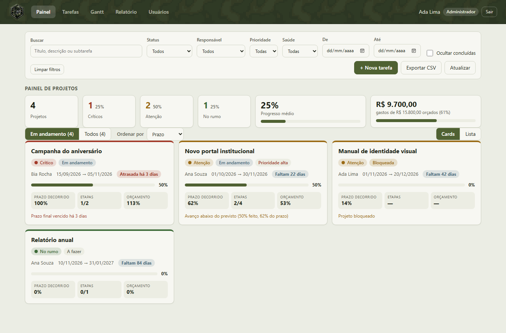
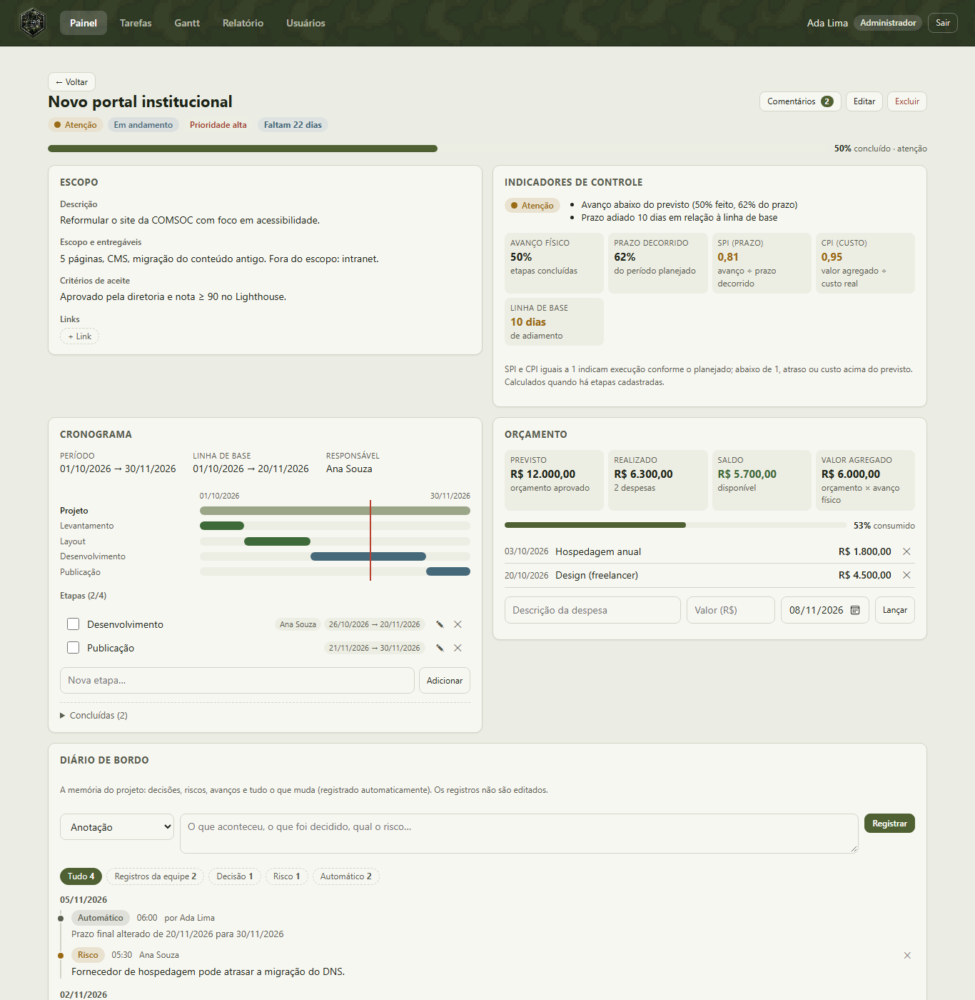
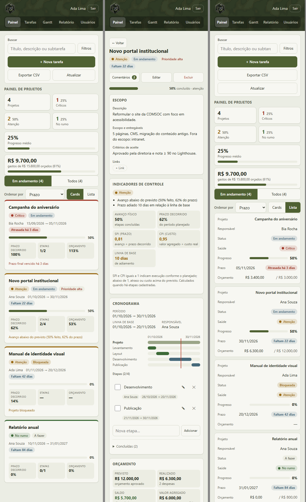

# Tarefas COMSOC

**Gestão de projetos leve para equipes de comunicação:** cada tarefa é um projeto com escopo,
cronograma, orçamento, indicadores de controle e um diário de bordo que guarda a memória do
trabalho. Inclui painel em cards ou lista, Gantt, relatórios por pessoa e perfis de acesso.

[](https://github.com/Cezar-Tosta/tarefas_comsoc/actions/workflows/deploy.yml)


> _English summary:_ a lightweight project-management web app (TypeScript, no framework,
> Supabase/Postgres with Row Level Security). Each task is a project with scope, schedule
> baseline, budget and expenses, earned-value indicators (SPI/CPI), a health score and an
> append-only logbook fed by database triggers. Deployed as a static site on GitHub Pages.



<table>
  <tr>
    <td width="62%"></td>
    <td></td>
  </tr>
  <tr>
    <td align="center"><sub>Página do projeto: escopo, controle, cronograma, orçamento e diário</sub></td>
    <td align="center"><sub>Celular: painel, projeto e lista</sub></td>
  </tr>
</table>

<sub>Capturas com dados fictícios.</sub>

## Destaques

| Área | O que tem |
| --- | --- |
| **Projeto** | Escopo e entregáveis, critérios de aceite, responsável, prioridade, links e etapas (subtarefas) com dependência "começa após". |
| **Cronograma** | Período planejado, **linha de base** gravada pelo banco, desvio em dias e mini-cronograma das etapas com a linha de hoje. |
| **Orçamento** | Previsto × realizado, lançamento de despesas, saldo, % consumido e **valor agregado**. |
| **Controle** | Avanço físico, prazo decorrido, **SPI** e **CPI** e uma **saúde** (no rumo, atenção, crítico) que explica os motivos. |
| **Diário de bordo** | Anotações, avanços, decisões, riscos, problemas e marcos, mais **registros automáticos** de toda mudança relevante. Os registros não podem ser editados. |
| **Painel** | Projetos em andamento em **cards ou lista**, com indicadores do portfólio, ordenação (prazo, saúde, progresso, nome) e filtros. |
| **Gantt** | Aba própria com escala dia/semana/mês, subtarefas, linha de hoje, saúde por projeto e os mesmos filtros. |
| **Equipe** | Relatório por pessoa com gráficos, comentários em formato de chat com aviso de mensagens novas, lista de arquivados, exportação CSV. |
| **Acesso** | Perfis Administrador, Usuário, Visualizador e Aguardando aprovação, com as regras **aplicadas no banco** (RLS). |
| **Responsivo** | Ajustado para celular (360 px ou mais), notebook (1366×768) e telas largas. Pode ser instalado como app (PWA). |

Os detalhes de cada indicador estão em [docs/GESTAO-DE-PROJETOS.md](docs/GESTAO-DE-PROJETOS.md)
e as decisões técnicas em [docs/ARQUITETURA.md](docs/ARQUITETURA.md).

## Stack

- **Front-end:** TypeScript estrito, sem framework. A renderização usa um template tag próprio
  que escapa todo o HTML por padrão. Build com Vite.
- **Back-end:** Supabase, com Auth e Postgres. A segurança fica em políticas **Row Level
  Security** e em gatilhos (`supabase/*.sql`).
- **Qualidade:** `tsc --noEmit`, `oxlint`, `oxfmt` e **vitest**, com mais de 200 testes da lógica
  pura e das telas.
- **Entrega:** GitHub Actions roda typecheck, lint, testes e build e publica no GitHub Pages.
  As actions são fixadas por SHA.

```
src/
├── lib/        lógica pura e testada: controle (SPI/CPI/saúde), diário, filtros, Gantt,
│               progresso, permissões, relatórios, CSV, datas
├── ui/         telas (views.ts, project.ts) e o template tag seguro (html.ts)
├── app.ts      eventos, ações e formulários
├── api.ts      acesso ao Supabase
└── state.ts    estado da aplicação e preferências salvas no navegador
supabase/       esquema, migrações, RLS e gatilhos (diário automático, linha de base)
docs/           arquitetura, indicadores e capturas de tela
```

## Perfis

| Perfil | Pode |
| --- | --- |
| Administrador | Tudo: criar, editar e excluir projetos e etapas, orçamento e despesas, atribuir responsáveis e gerir usuários |
| Usuário | Nos projetos ligados a ele: concluir, comentar e registrar no diário de bordo. Não altera dados nem exclui |
| Visualizador | Somente consulta |
| Aguardando aprovação | Sem acesso até um administrador definir o perfil |

O **primeiro cadastro vira administrador**. Os seguintes entram como "aguardando aprovação".
A interface só esconde o que não se pode fazer. Quem realmente bloqueia é o banco.

## Como rodar

### 1. Banco (Supabase)

1. Crie um projeto em <https://supabase.com>.
2. No **SQL Editor**, execute **em ordem** o conteúdo de:

   | Arquivo | Para quê |
   | --- | --- |
   | `supabase/schema.sql` | Tabelas, perfis, RLS e gatilhos base |
   | `002_comments_links.sql` | Comentários e links |
   | `003_user_visibility.sql` | Cada usuário vê só o que está ligado a ele |
   | `004_delete_user.sql` | Excluir usuários pela aba Usuários |
   | `005_subtask_start_after.sql` | Etapa que começa após o término de outra |
   | `006_user_completes_only.sql` | **Importante:** no banco, usuários só concluem e comentam |
   | `007_task_completed_at.sql` | Data de conclusão (base dos Arquivados) |
   | `008_project_management.sql` | **Gestão de projeto:** escopo, orçamento, despesas, linha de base e diário de bordo |

   Sem uma migração, o recurso correspondente fica oculto ou avisa o que falta, e o restante
   continua funcionando.

3. Em **Authentication → Providers → Email**, desative **"Confirm email"**. Assim as novas
   contas só aguardam a aprovação de um administrador. Em **Authentication → URL
   Configuration**, informe a URL do Pages (`https://<usuario>.github.io/<repo>/`).
4. Copie **Project URL** e a chave **anon** (Project Settings → API).

### 2. Local

```bash
cp .env.example .env.local   # preencha VITE_SUPABASE_URL e VITE_SUPABASE_ANON_KEY
pnpm install
pnpm dev                     # http://localhost:5173
```

Cadastre-se pelo próprio site com o e-mail do administrador.

### 3. GitHub Pages

1. _Settings → Pages → Source_: **GitHub Actions**.
2. _Settings → Secrets and variables → Actions → **Variables**_: crie `VITE_SUPABASE_URL` e
   `VITE_SUPABASE_ANON_KEY`.
3. Cada push em `main` valida e publica (`.github/workflows/deploy.yml`).

> A chave `anon` é pública por design. A proteção dos dados está nas políticas RLS. **Nunca**
> use a chave `service_role` no front-end.

## Desenvolvimento

```bash
pnpm check     # tsc + oxlint + vitest
pnpm test      # só os testes
pnpm build     # gera dist/
pnpm format    # oxfmt
```

O logo original fica em `design/logo-original.png`. Para gerar de novo os ícones (favicon,
PWA, iPhone), rode `python scripts/make-icons.py` (precisa de Pillow, numpy e scipy).

## Roadmap

- Curva S (planejado × realizado) e histórico de SPI/CPI ao longo do tempo
- Matriz de riscos (probabilidade × impacto) a partir do diário de bordo
- Arrastar barras do Gantt e setas de dependência
- Comentários e diário em tempo real (Supabase Realtime)
- Anexos de arquivos e modelos de projeto
- Avisos de prazo por e-mail

## Licença

[MIT](LICENSE) © Cezar Tosta
