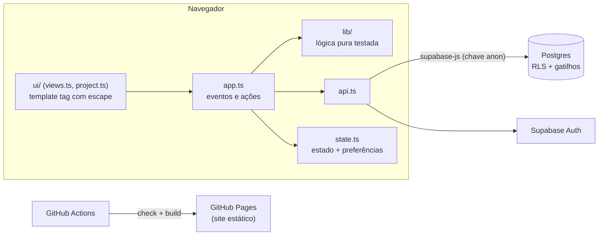
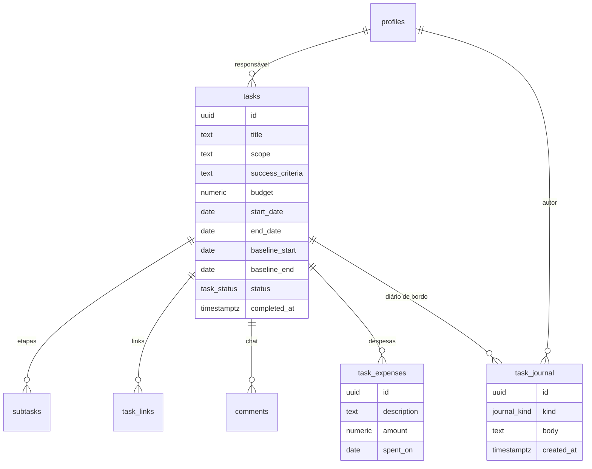

# Arquitetura

## Visão geral

- **Sem framework.** O estado fica em um único objeto (`state.ts`). Cada ação altera o estado e
  redesenha a área afetada. A barra de filtros não é recriada enquanto o usuário digita, para
  não perder o foco.
- **HTML seguro por padrão.** O template tag `html` escapa toda interpolação. Só `raw()` e
  outros `html` passam sem escape. Os testes verificam o escape do texto do usuário.
- **Lógica separada da tela.** `src/lib/` não toca no DOM e é coberta por testes unitários.
  As telas também têm testes que verificam o HTML gerado.

## Modelo de dados

## Segurança

A interface só esconde botões. **Quem bloqueia é o banco:**

| Regra | Onde |
| --- | --- |
| Quem vê o quê (usuário só vê o que está ligado a ele) | `can_see_task()` + políticas `*_select` (003) |
| Usuário só conclui e comenta | gatilhos `tasks_guard` e `subtasks_guard` (006/007) |
| Despesas só pelo administrador | políticas de `task_expenses` (008) |
| Diário sem edição; automáticos só pelo banco | sem `grant update`; `insert` exige `kind <> 'system'` (008) |
| Registro automático com o autor real | `journal_log()` com `security definer` e `auth.uid()`, sem execução por RPC |

As funções `security definer` fixam `search_path = public`. As funções internas também têm a
execução revogada para `anon` e `authenticated`.

## Migrações tolerantes

O app funciona com qualquer subconjunto das migrações. `api.fetchTasks()` tenta primeiro a
consulta mais completa e, se uma relação ainda não existir (`PGRST200`), cai para a próxima.
Assim ele descobre quais recursos estão disponíveis (`state.extras` e `state.project`) e esconde
ou explica o que falta.

## Decisões

- **Indicadores no cliente:** SPI, CPI e saúde dependem da data de hoje e mudam todo dia. Gravar
  esses valores exigiria uma tarefa agendada. Calculados no cliente, ficam testáveis e sempre
  atuais.
- **Linha de base no banco:** precisa ser confiável. Por isso o gatilho a preenche, e não o
  formulário.
- **Diário por gatilhos:** nenhuma mudança escapa da memória do projeto, mesmo quando é feita
  por outro cliente ou direto no SQL Editor.
- **Atualização por polling (60 s; chat 8 s)** em vez de Realtime, para simplificar e consumir
  menos recursos. O Realtime está no roadmap.

## Responsividade

| Faixa | Ajustes |
| --- | --- |
| ≤ 720 px (celular) | abas roláveis, filtros recolhidos atrás de um botão, tabelas viram cartões, diálogos quase em tela cheia, alvos de toque ≥ 40 px, campos com 16 px (evita o zoom do iOS) |
| 721–1100 px (notebook pequeno / tablet) | menos espaço lateral, rótulo do Gantt mais estreito |
| altura ≤ 800 px | barra superior mais baixa (notebooks 1366×768) |
| ≥ 1000 px | página do projeto em 2 colunas; a partir de 1400 px, 3 colunas |
| ≥ 1440 px | conteúdo até 1440 px de largura |
